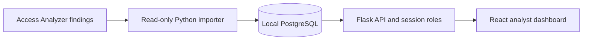

# Architecture

This document separates the current prototype from the intended pilot architecture. Update the target design as implementation decisions are made.

## Current repository

The repository currently contains a React and TypeScript dashboard with synthetic fixtures. It uses the API contract from the separate Cloud Security Findings Tracker for local preview. This repository does not yet contain its own Flask service, PostgreSQL schema, or AWS integration.

## Intended local pilot

The importer uses temporary AWS credentials supplied through the normal credential provider chain. It reads bounded pages from one approved analyzer, validates records against an allowlist, and writes through the application's import boundary. AWS credentials never enter the browser.

The local API owns authentication, role checks, analyst actions, and aggregate responses. The React client renders the paginated queue and charts but does not calculate whole-dataset totals from the current page.

## Data ownership

| Provider-owned fields | Analyst-owned fields |
|---|---|
| Source and analyzer-scoped provider key | Triage status |
| Resource type and approved resource summary | Notes and resolution reason |
| Provider status and provider timestamps | Audit history and actor |
| Explicitly approved evidence summary | Local priority, if defined |

Keep provider status distinct from the analyst's triage status. An import updates provider-owned fields only. Re-import must preserve analyst decisions, notes, and audit history.

## Aggregate contracts

Analytics endpoints must use the same authorization and filter semantics as the findings queue, then aggregate across all matching records. They must not infer totals from a paginated list response.

- Resource-type counts include a defined unknown bucket and state their filter scope.
- Time-series buckets use an explicitly selected provider timestamp and timezone convention.
- Regional summaries classify location as a Region, global, or unknown.
- Source-IP geography, if added, is labeled separately from resource Region.
- Local priority is a documented application rule, not provider severity.

## Trust boundaries

- AWS access is read-only and limited to the approved analyzer and Region.
- Only allowlisted fields cross from provider responses into the application database.
- Analyst writes go through authenticated, role-checked API endpoints and create transactional audit events.
- Real findings stay in the approved local database and do not enter Git, CI logs, or public screenshots.
