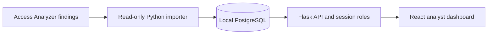

# Architecture

This document separates the current prototype from the intended pilot architecture. Update the target design as implementation decisions are made.

## Current repository

The repository contains a React and TypeScript dashboard and its own Flask/PostgreSQL API. The local Compose stack loads fabricated findings, and the API provides session-based analyst/viewer roles, notes, status changes, audit history, and server-side summary and analytics responses. A bounded Access Analyzer adapter supports a synthetic preview and confirmed local fixture import. There is no live AWS connection.

The analytics endpoint applies the selected status, severity, and source filters to the full set of findings observed in the last 30 UTC calendar days. It returns resource-type counts and one daily bucket per UTC date, including dates with zero findings. The table's page and page size do not affect aggregates.

Findings store resource placement in typed `resource_location_scope` and `resource_region` fields. A legacy `metadata.region` is not treated as resource location; migrated records with ambiguous legacy values remain `unknown`. This keeps an event or source-IP Region separate from the affected resource's placement. A filtered region analytics endpoint reports counts by explicit Region and separate totals for global and unknown locations.

The dashboard plots approximate positions for a curated set of AWS Region codes. Codes without a plotted position remain in the adjacent count list. Global and unknown resources are summarized separately and do not receive coordinates.

Finding details show provider status, public access, and provider timestamps in a read-only section when those fields exist. Analyst status and status-change controls remain separate. The queue labels the application-assigned `severity` values as Triage priority and explains the Access Analyzer priority rule in the drawer.

## Intended local pilot

The importer uses temporary AWS credentials supplied through the normal credential provider chain. It reads bounded pages from one approved analyzer, validates records against an allowlist, and writes through the application's import boundary. AWS credentials never enter the browser.

The local API owns authentication, role checks, analyst actions, and aggregate responses. The React client renders the paginated queue and charts but does not calculate whole-dataset totals from the current page.

## Data ownership

| Provider-owned fields | Analyst-owned fields | Application-derived fields |
|---|---|---|
| Source and analyzer-scoped provider key | Triage status | Local priority stored in `severity` and displayed as Triage priority |
| Resource type, public-access flag, and provider timestamps | Notes and resolution reason | Generated title and summary |
| Provider status and allowlisted resource summary | Audit history and actor | Resource location classification |

Keep provider status distinct from the analyst's triage status. An import updates provider-owned and application-derived fields only. Re-import preserves analyst decisions, notes, and audit history.

## Aggregate contracts

Analytics endpoints must use the same authorization and filter semantics as the findings queue, then aggregate across all matching records. They must not infer totals from a paginated list response.

- The current analytics endpoint filters by analyst status, severity, and source. Both charts describe the same filtered cohort and 30-day UTC window.
- Resource-type counts include an `Unknown` bucket for absent, blank, or unreasonably long values.
- Time-series buckets use the finding's `observed_at` timestamp normalized to UTC and include zero-count dates.
- Regional summaries classify location as a Region, global, or unknown.
- Source-IP geography, if added, is labeled separately from resource Region.
- Local priority is a documented application rule, not provider severity.

## Trust boundaries

- AWS access is read-only and limited to the approved analyzer and Region.
- Only allowlisted fields cross from provider responses into the application database.
- Analyst writes go through authenticated, role-checked API endpoints and create transactional audit events.
- Real findings stay in the approved local database and do not enter Git, CI logs, or public screenshots.
